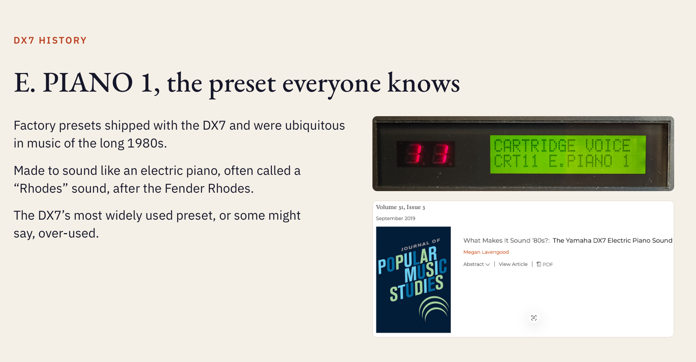

## Using AI

AI lets us talk to the computer in natural language.

--

## Using AI

Use AI for automation of computational or repetitive tasks like

- spell/grammar checking
- standardizing terms/format/etc.
- using a template (that **you** created) and data to generate several different versions of the same thing
- turning data into charts

--

## Using AI

Use AI to communicate with the computer. **Do not use it for communicating with other humans.**

- Don't use it for writing your slides.
- Don't use it for writing your script.
- Don't use it for writing your emails.

--

## AI slide deck examples

<b><u>Megan's Rating</u></b>

★★☆☆☆ 
2/5 
too many words

--

## AI slide deck examples

<b><u>Megan's Rating</u></b>

★★☆☆☆ 
2/5 
too many words (even with pics)

--

## AI slide deck examples

<b><u>Megan's Rating</u></b>

★★☆☆☆ 
2/5 
too many images

--

## AI slide deck examples

<b><u>Megan's Rating</u></b>

★★★☆☆ 
3/5 
too many fonts and styles and colors

--

## AI slide deck examples

<b><u>Megan's Rating</u></b>

★★★☆☆ 
3/5 
Unfortunate residue from being trained on internet data

--

## Using AI

AI was made to write computer code and is thus bad at creative work

so use it to write computer code, not for creative work
