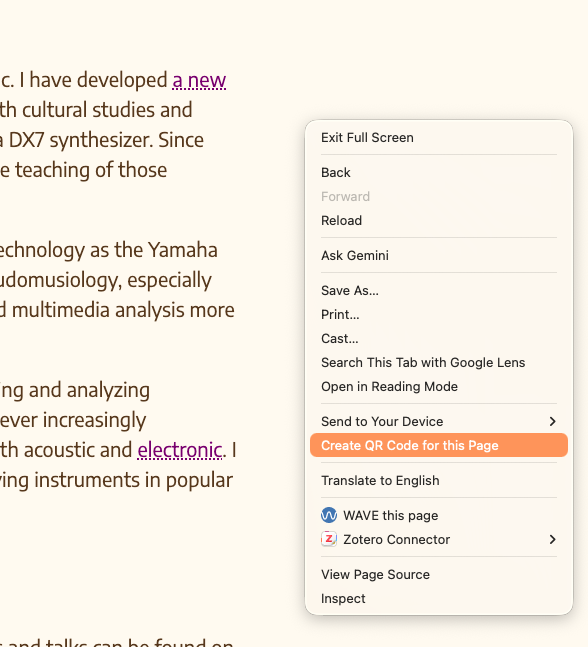

## Put stuff on the internet

Let people see your slides from anywhere

1. Have a personal website or Knowledge Commons profile
2. Put your slides/script online
3. Create a QR code for your slides
4. Put the QR code on the slides

--

## Put stuff on the internet

### 1. Have a personal website

- [**Knowledge Commons**](http://kcommons.org) is designed for academics to share work, and will provide a Wordpress site too
- Control your search results
- Academia.edu is scammy, avoid

--

## Put stuff on the internet

### 2. Put your slides/script online

- Upload a **PDF** (NOT a .pptx) to your website or wherever
- People can access your slides even if they can't see them in the room

--

## Put stuff on the internet

### 3. Create a QR code for your slides

(QR codes are links encoded into pixels so phones can scan them)

**Using Chrome:**

1. right-click on the page and generate a QR code
2. download

--

## Put stuff on the internet

### 3. Create a QR code for your slides

--

## Put stuff on the internet

### 3. Create a QR code for your slides

Other options besides Chrome:

- random websites on the internet, idk
- command-line tools like [QRencode](https://github.com/fukuchi/libqrencode)

--

## Put stuff on the internet

### 4. Put the QR code on the slides

- Make it nice and big
- **Test it!**
