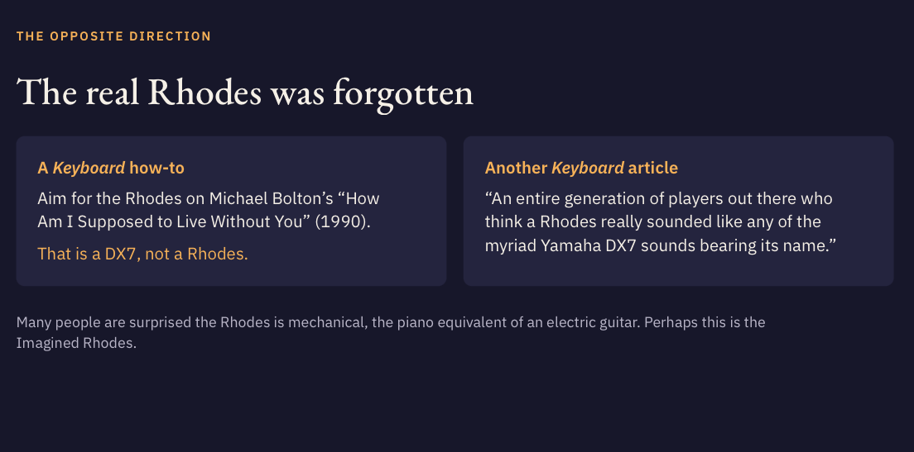
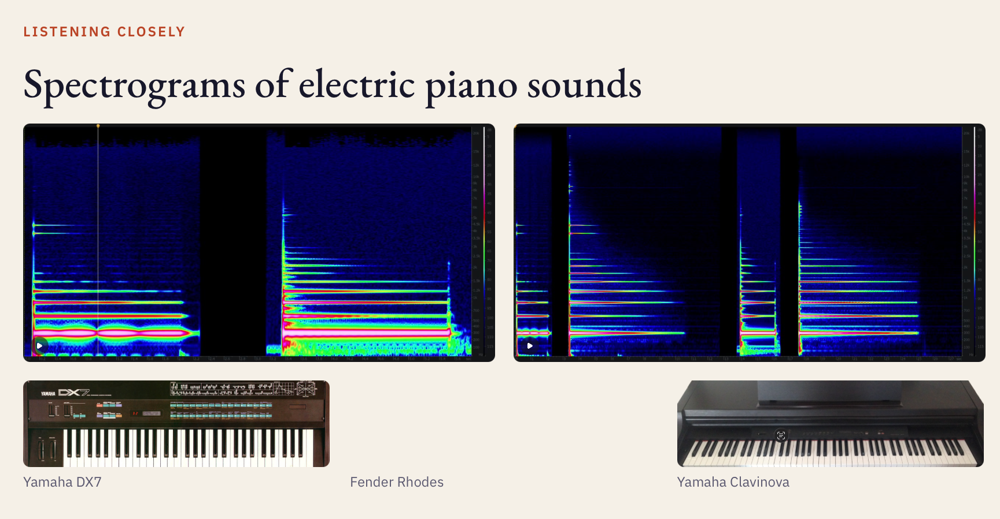
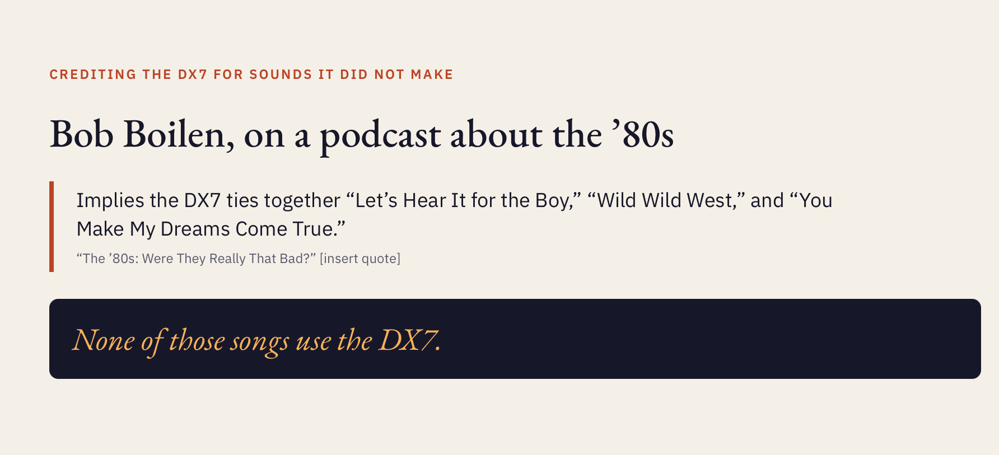

## Using AI

AI lets us talk to the computer in natural language.

--

## Using AI

Automation of computational or repetitive tasks like

- spell/grammar checking
- standardizing terms/format/etc.
- using a template (that **you** created) and data to generate several different versions of the same thing
- turning data into charts

--

## Using AI

AI is **bad at being a human**.

Do not use it for communicating with other humans.

- Don't use it for writing your slides.
- Don't use it for writing your script.
- Don't use it for writing your emails.

--

## AI slide deck examples

Too many words

--

## AI slide deck examples

Too many words (even with pics)

--

## AI slide deck examples

Too many images

--

## AI slide deck examples

Too many fonts/colors/styles

--

## AI slide deck examples

Unfortunate residue from being trained on internet data

---
